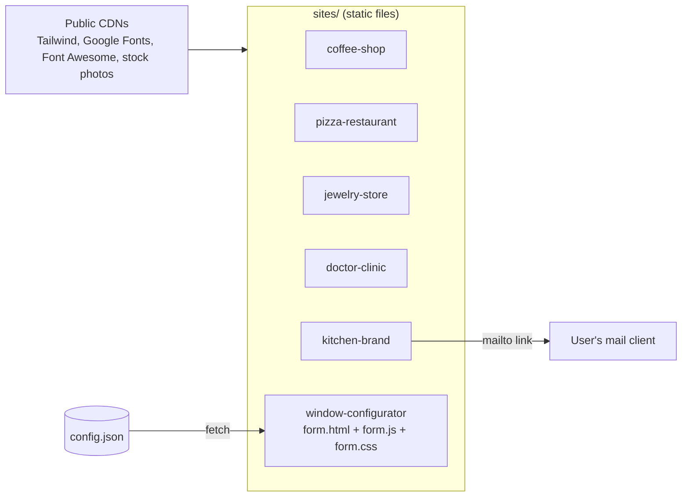

<p align="center">
  
</p>

<p align="center">
  
</p>

<p align="center">
  
  
  
  
  
</p>

<p align="center">
  
</p>

## Table of contents

- [Overview](#-overview)
- [Features](#-features)
- [The sites and screenshots](#-the-sites-and-screenshots)
- [Architecture](#-architecture)
- [Tech stack](#-tech-stack)
- [Requirements](#-requirements)
- [Installation and configuration](#-installation-and-configuration)
- [Usage](#-usage)
- [Project structure](#-project-structure)
- [Testing](#-testing)
- [Troubleshooting and FAQ](#-troubleshooting-and-faq)
- [Roadmap](#-roadmap)
- [Contributing](#-contributing)
- [License](#-license)
- [Author](#-author)

## 🧭 Overview

**Problem.** Small-business clients (a coffee shop, a kitchen maker, a clinic, a jewelry store, a pizzeria, a window seller) need a credible, mobile-friendly web page quickly, often without a build pipeline or hosting budget.

**Solution.** Six independent, framework-free landing pages and UI prototypes built with plain HTML, Tailwind CSS and vanilla JavaScript. Each one opens straight from its HTML file, is mobile-first and, where relevant, includes floating contact buttons (call / WhatsApp / Messenger / Telegram).

## ✨ Features

- Mobile-first layouts for every site, with mobile screenshots captured for each
- Glass-style hero card, menu and origins sections (coffee shop)
- Shop grid with price-range filter, top-rated sidebar, cart badge and WhatsApp bubble (pizza restaurant)
- Looping muted hero video, category circles and product cards (jewelry store)
- Services, doctors and online-appointment sections with floating messaging buttons (clinic)
- French-language catalogue page with a contact form that composes a `mailto:` message (kitchen brand)
- Data-driven purchase form: models, colours and preview image loaded from `config.json` by `form.js` (window configurator)

## 🎬 The sites and screenshots

Each site lives in `sites/<name>/`.

| Site | What it demonstrates | Preview |
|---|---|---|
| `coffee-shop` | Hero with glass-style card, menu and origins sections, image-rich layout |  |
| `pizza-restaurant` | Shop grid, price-range filter, top-rated sidebar, cart badge, WhatsApp bubble |  |
| `jewelry-store` | Looping muted hero video, category circles, product cards |  |
| `doctor-clinic` | Services, doctors, online-appointment sections and floating messaging buttons |  |
| `kitchen-brand` | French-language catalogue page for a kitchen maker, contact form that composes a `mailto:` message |  |
| `window-configurator` | Data-driven purchase form: models, colours and preview image loaded from `config.json` by `form.js` |  |

<details>
<summary><b>Mobile views</b></summary>

| Coffee | Pizza | Jewelry | Clinic | Kitchen |
|---|---|---|---|---|
|  |  |  |  |  |

</details>

## 🏗 Architecture

There is no shared code or build step: every site is a self-contained page that pulls Tailwind and fonts from public CDNs. The window configurator is the only one with data loading.



## 🧰 Tech stack

| Layer | Tools |
| --- | --- |
| Markup | HTML5 |
| Styling | Tailwind CSS (CDN build) |
| Behaviour | Vanilla JavaScript |
| Fonts / icons | Google Fonts (Inter, Montserrat), Font Awesome (jewelry store) |

## 📋 Requirements

| Item | Requirement |
| --- | --- |
| OS | Windows, macOS or Linux |
| Browser | Any modern browser |
| Static server | Any (for example Python 3 `http.server`). Only needed for the window configurator, which `fetch`es `config.json`; the other pages open from the file system |
| Network | Internet access: Tailwind and most stock photos load from public CDNs |
| Runtime / database / GPU | None |
| Ports | `8000` in the example below (any free port works) |
| Accounts / API keys | None |
| Environment variables | None |

## ⚙ Installation and configuration

```bash
git clone https://github.com/ORD1STAR/web-design-showcase.git
cd web-design-showcase
```

There is no install step and no configuration. The contact links in the demo pages are placeholders (`wa.me/968XXXXXXXX`, `tel:+213XXXXXXXXX`, `contact@example.com`); replace them with real values before using a page. The window configurator is configured through `sites/window-configurator/config.json`.

## 🚀 Usage

Serve the repository root with any static server:

```bash
python -m http.server 8000
# then open
#   http://localhost:8000/sites/coffee-shop/index.html
#   http://localhost:8000/sites/window-configurator/form.html
```

Other pages: `sites/pizza-restaurant/index.html`, `sites/jewelry-store/index.html`, `sites/doctor-clinic/index.html`, `sites/kitchen-brand/index.html`.

## 🗂 Project structure

<details>
<summary><b>Show tree</b></summary>

```
sites/
  coffee-shop/          index.html
  pizza-restaurant/     index.html
  jewelry-store/        index.html, jews.mp4 (hero video)
  doctor-clinic/        index.html
  kitchen-brand/        index.html, imgs/
  window-configurator/  form.html, form.js, form.css, config.json, assets/
docs/                   screenshots and scroll GIFs (captured with headless Chromium)
```

</details>

## 🧪 Testing

There is no automated test suite; these are static visual prototypes. Check them manually in a browser at desktop and mobile widths.

## 🩺 Troubleshooting and FAQ

<details>
<summary><b>The window configurator shows no models or colours</b></summary>

It loads `config.json` with `fetch`, which browsers block on `file://` URLs. Serve the repository with a static server as shown in Usage.

</details>

<details>
<summary><b>Pages look unstyled or images are missing</b></summary>

Tailwind and most stock photos load from public CDNs, so you need an internet connection. Several stock photos are hot-linked from third-party sites for prototyping and may disappear.

</details>

<details>
<summary><b>Are the phone numbers and emails real?</b></summary>

No. Brand names, phone numbers and e-mail addresses in the demo pages are placeholders. Contact details from the original client pages were removed.

</details>

<details>
<summary><b>Does the configurator form submit anywhere?</b></summary>

No, it is a front-end prototype.

</details>

## 🗺 Roadmap

- [x] Six responsive landing pages and prototypes
- [x] Mobile screenshots and scroll GIFs for the pages
- [ ] Replace hot-linked stock photos with licensed local assets
- [ ] Bundle Tailwind locally instead of the CDN build for production use
- [ ] Wire the configurator form and contact buttons to a real back end

Original screen-recording videos of the pages (about 35 MB) were left out of the repository; the GIFs in `docs/` are freshly captured from the running pages.

## 🤝 Contributing

Issues and pull requests are welcome. Keep each site self-contained and use placeholder contact details only.

## 📄 License

Released under the [MIT License](LICENSE).

## 👤 Author

<table>
  <tr>
    <td><b>Hannoun Amine Amar</b><br/>AI Engineer / Fullstack Developer, Algeria</td>
    <td>
      <a href="https://www.linkedin.com/in/hannoun-amine/"></a>
      <a href="mailto:hannoun.amine25@gmail.com"></a>
      <a href="https://github.com/ORD1STAR"></a>
    </td>
  </tr>
</table>

<p align="center">
  
</p>
