# Web Design Showcase

Six responsive, framework-free landing pages and UI prototypes for small-business clients (coffee shop, kitchen maker, clinic, jewelry store, pizzeria, window configurator), built with plain HTML, Tailwind CSS and vanilla JavaScript.


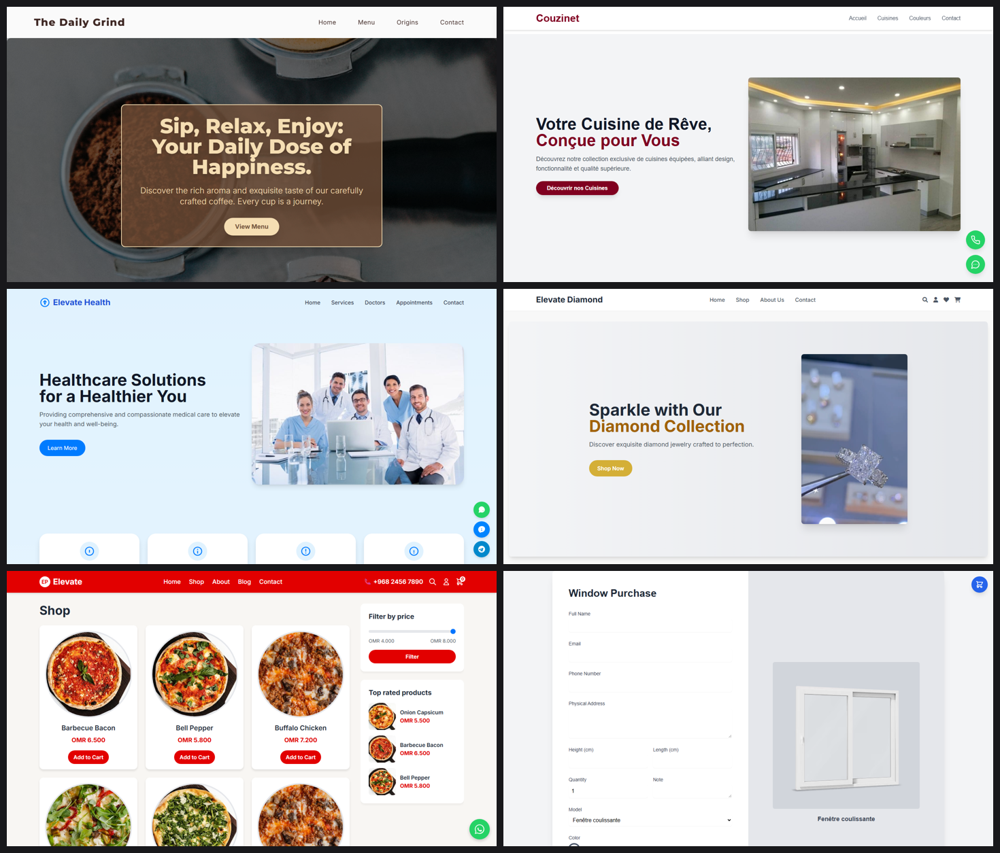

## The sites

Each site lives in `sites/<name>/` and opens directly from its HTML file. All of them are mobile-first and include floating contact buttons (call / WhatsApp / Messenger / Telegram) where relevant.

| Site | What it demonstrates | Preview |
|---|---|---|
| `coffee-shop` | Hero with glass-style card, menu and origins sections, image-rich layout | 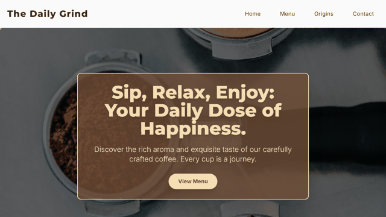 |
| `pizza-restaurant` | Shop grid, price-range filter, top-rated sidebar, cart badge, WhatsApp bubble | 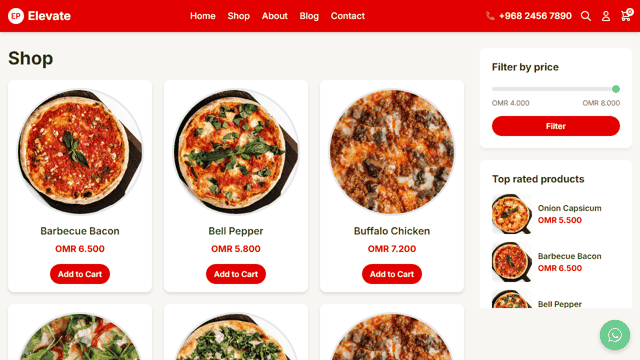 |
| `jewelry-store` | Looping muted hero video, category circles, product cards | 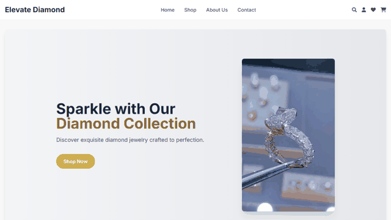 |
| `doctor-clinic` | Services, doctors, online-appointment sections and floating messaging buttons | 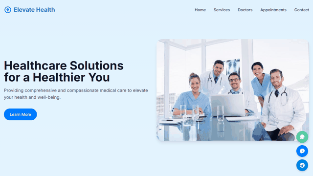 |
| `kitchen-brand` | French-language catalogue page for a kitchen maker, contact form that composes a `mailto:` message | 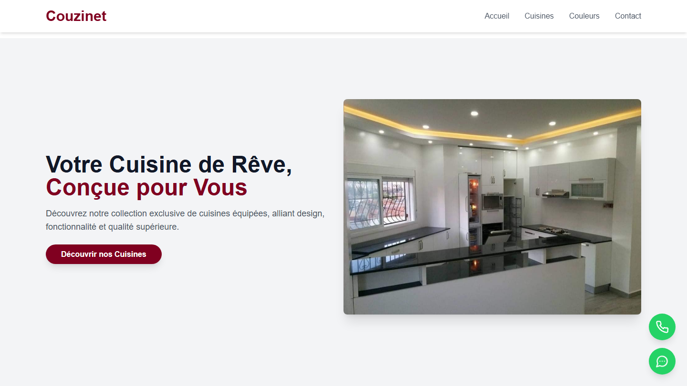 |
| `window-configurator` | Data-driven purchase form: models, colours and preview image loaded from `config.json` by `form.js` | 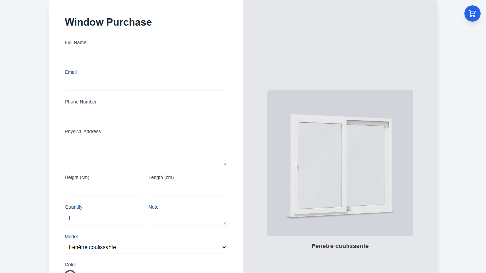 |

### Mobile views

| Coffee | Pizza | Jewelry | Clinic | Kitchen |
|---|---|---|---|---|
| 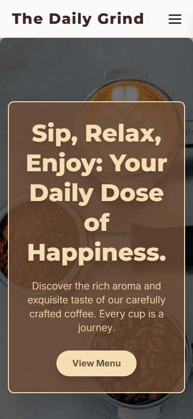 | 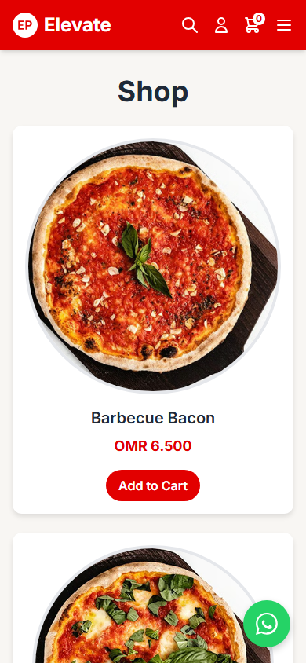 | 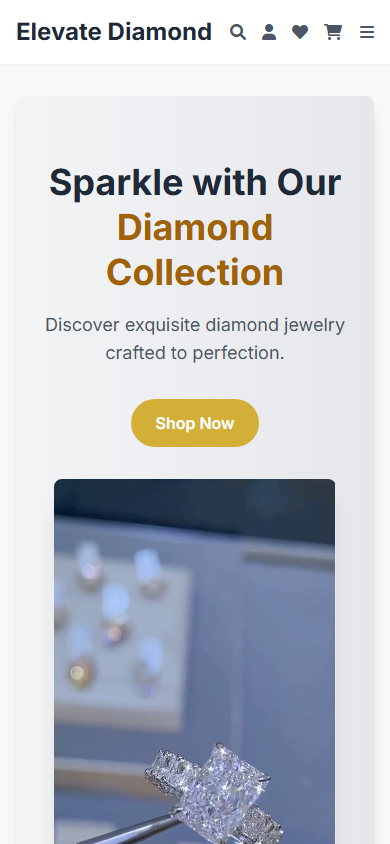 |  | 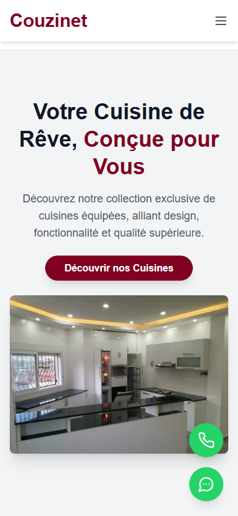 |

## Tech stack

HTML5, Tailwind CSS (CDN build), vanilla JavaScript, Google Fonts (Inter, Montserrat), Font Awesome (jewelry store).

## Getting started

No build step. Serve the repository root with any static server (needed for the configurator, which `fetch`es `config.json`):

```bash
python -m http.server 8000
# then open
#   http://localhost:8000/sites/coffee-shop/index.html
#   http://localhost:8000/sites/window-configurator/form.html
```

Note: Tailwind and most stock photos are loaded from public CDNs, so an internet connection is required to view the pages as shown.

## Project structure

```
sites/
  coffee-shop/          index.html
  pizza-restaurant/     index.html
  jewelry-store/        index.html, hero.mp4 (2.4 MB hero video)
  doctor-clinic/        index.html
  kitchen-brand/        index.html, imgs/
  window-configurator/  form.html, form.js, form.css, config.json, assets/
docs/                   screenshots and scroll GIFs (captured with headless Chromium)
```

## Notes

- Brand names, phone numbers and e-mail addresses in the demo pages are placeholders. Contact details from the original client pages were removed.
- Several stock photos are hot-linked from third-party sites for prototyping and are not part of this repository. Replace them with licensed assets before production use.
- The configurator form does not submit anywhere; it is a front-end prototype.
- Original screen-recording videos of the pages (about 35 MB) were left out of the repository; the GIFs in `docs/` are freshly captured from the running pages.

## Author

Hannoun Amine Amar, Algeria
[LinkedIn](https://www.linkedin.com/in/hannoun-amine/) | hannoun.amine25@gmail.com

Licensed under the MIT License.
